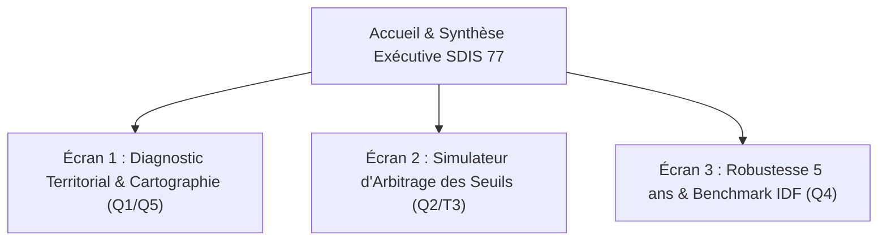

# Wireframes & Maquettes Ergonomiques — Rapport Power BI (SDIS 77)

**Auteure :** Linda MAKAMTA (Responsable Data Analytics, KPIs & BI)  
**Palette Graphique :** Charte sécurité civile & incendie (Bleu nuit `#1B365D`, Rouge alerte `#D9381E`, Orange vigilance `#E67E22`, Vert calme `#27AE60`, Fond gris clair `#F8F9FA`).

---

## 1. Vue d'Ensemble des Écrans (Architecture de Navigation)



---

## 2. Wireframe Écran 1 — Cartographie Stratégique & Diagnostic Territorial

```text
+----------------------------------------------------------------------------------------------------+
|  SDIS 77 - PRÉVENTION FEUX DE FORÊT 2027                    [Filtre Année: 2023 v] [Massif: Tous v]|
+----------------------------------------------------------------------------------------------------+
| [ KPI 1: DÉPARTS DE FEU ]  [ KPI 2: SURFACE BRÛLÉE ]  [ KPI DÉCISION: RATIO ]  [ PROXY ATTAQUE ]   |
|         28 feux                    24,5 ha              0,17 ha / 1 000 ha           87,6 % < 1ha  |
+---------------------------------------------------+------------------------------------------------+
|  CARTE CHOROPLÈTHE DE SEINE-ET-MARNE              |  TOP 10 COMMUNES / MASSIFS EXPOSÉS             |
|  (Rapportée à la surface boisée IGN)              |                                                |
|                                                   |  Fontainebleau      ███████████████████ 0,42   |
|         .---.                                     |  Crécy-la-Chapelle  ████████████ 0,28          |
|        /     \   (Massif de Crécy)                |  Villefermoy        █████████ 0,21             |
|       |  77   |                                   |  Nemours            ███████ 0,16               |
|        \     /   (Massif de Fontainebleau)        |  Avon               ██████ 0,14                |
|         '---'    * Zone critique Sud *            |  Moret-Loing        █████ 0,11                 |
|                                                   |  La Ferté-sous-Jou. ████ 0,09                  |
|  [Légende: Vert <0,1 | Jaune 0,1-0,3 | Rouge >0,5] |  Bourron-Marlotte   ███ 0,07                   |
+---------------------------------------------------+------------------------------------------------+
|  RÉPARTITION PAR GROUPEMENT DU SDIS 77 :  [ Sud 58% ]  [ Nord 18% ]  [ Centre 14% ]  [ Est 10% ]   |
+----------------------------------------------------------------------------------------------------+
```

---

## 3. Wireframe Écran 2 — Simulateur d'Arbitrage des Seuils de Vigilance

```text
+----------------------------------------------------------------------------------------------------+
|  SIMULATEUR DE SEUIL DE DÉCLENCHEMENT - SAISON 2027               [Scénario Actif: OPTION C (Ciblé)]|
+----------------------------------------------------------------------------------------------------+
|  SÉLECTEUR DE SCÉNARIO :                                                                           |
|  ( ) Option A : Seuil Orange Uniforme    ( ) Option B : Seuil Jaune Uniforme    (*) Option C Gradué|
+---------------------------------------------------+------------------------------------------------+
|  MATRICE DE CONFUSION DU DISPOSITIF (2023)        |  IMPACT BUDGÉTAIRE ET OPÉRATIONNEL             |
|                                                   |                                                |
|               Feu Réel        Aucun Feu           |  Taux de Couverture des Feux Réels :           |
|  Mobilisé :   23 jours (VP)   16 jours (FP)       |  [████████████████████████░░░░] 82,1 %         |
|  Non Mob. :    5 jours (FN)   68 jours (VN)       |                                                |
|                                                   |  Journées Mobilisées sans Feu (Coût à vide) :  |
|  * Coût des Faux Positifs : 16 j x 4,5 k€ = 72 k€ |  16 journées mobilisées sans départ            |
|  * Sécurité : 82% des feux couverts à l'alerte    |                                                |
|  * Bilan Option C : Économie de 45 k€ vs Option B |  Enveloppe Astreinte Estimée :                 |
|    en protégeant Fontainebleau dès le Jaune.      |  72 000 € (Compatible budget CASDIS 2027)      |
+---------------------------------------------------+------------------------------------------------+
```

---

## 4. Wireframe Écran 3 — Robustesse Temporelle & Benchmark IDF

```text
+----------------------------------------------------------------------------------------------------+
|  ÉVALUATION DE LA ROBUSTESSE ET BENCHMARK RÉGIONAL                [Période Quinquennale: 2019-2023]|
+----------------------------------------------------------------------------------------------------+
|  HISTORIQUE QUINQUENNAL ET POIDS DE L'ANNÉE 2022                                                   |
|                                                                                                    |
|   2,0 |                       [2022: 1,56 ha / 1000 ha]                                            |
|   1,5 |                                 ███                                                        |
|   1,0 |                                 ███           -- Moyenne 5 ans (0,45) - BIAISÉE PAR 2022   |
|   0,5 |       ███                       ███                                                        |
|       |  0,30 ███   0,13 ███   0,09 ███ ███   0,17 ███== Médiane 5 ans (0,17) - RETENUE SDIS 77    |
|   0,0 +-------+----------+----------+---+----------+                                               |
|         2019       2020       2021     2022   2023                                                 |
+---------------------------------------------------+------------------------------------------------+
|  BENCHMARK ÎLE-DE-FRANCE (SURFACE BOISÉE BRÛLÉE)  |  TEST DE SENSIBILITÉ DES BASES                 |
|                                                   |                                                |
|  Seine-et-Marne (77)  ██████████████████ 0,45     |  Base Surface Boisée IGN (140 kh) : 0,45 ha    |
|  Yvelines (78)        ██████████ 0,26             |  Base Surface Totale INSEE (591 kh) : 0,11 ha   |
|  Essonne (91)         ████████ 0,21               |                                                |
|  Val-d'Oise (95)      █████ 0,14                  |  -> Conclusion : Le classement des massifs     |
|                                                   |     critiques reste 100 % stable.              |
+----------------------------------------------------------------------------------------------------+
```
