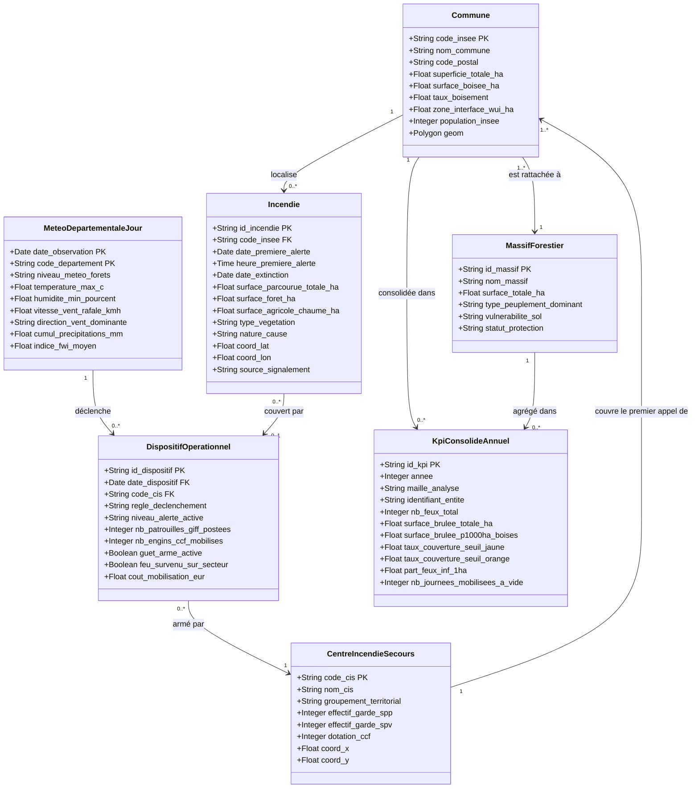

# 1. Diagramme UML de Classes — Modèle Conceptuel et Logique de Données

Ce document formalise la modélisation conceptuelle et logique des données de la plateforme d'aide à la décision feux de forêt pour la Seine-et-Marne (SDIS 77). Le modèle est conçu pour être exportable ou modélisable sous **StarUML** et visualisable directement via le diagramme Mermaid ci-dessous.

---

## 1.1 Diagramme de Classes UML (Rendu Mermaid)

---

## 1.2 Dictionnaire des Entités Métier

### 1. Entité `Commune` (Référentiel Spatial & Administratif)
- **Rôle** : Maille territoriale atomique permettant de réconcilier les données cadastrales, les massifs forestiers et les sinistres.
- **Attributs clés** :
  - `code_insee` (PK) : Code officiel géographique INSEE sur 5 caractères (ex. `77186` pour Fontainebleau).
  - `surface_boisee_ha` : Superficie forestière réelle issue de la BD Forêt IGN (> 140 000 ha au total sur la Seine-et-Marne).
  - `taux_boisement` : Ratio `surface_boisee_ha / superficie_totale_ha` (24 % en moyenne départementale, jusqu'à 85 % à Fontainebleau).
  - `zone_interface_wui_ha` : Surface de la zone d'interface habitat-forêt (bande des 50 mètres soumise aux Obligations Légales de Débroussaillement - OLD).

### 2. Entité `MassifForestier` (Périmètre Écologique & Géographique)
- **Rôle** : Regroupement cohérent des espaces boisés majeurs du département.
- **Attributs clés** :
  - `id_massif` (PK) : Identifiant unique normalisé (ex. `MASSIF_FONTAINEBLEAU`, `MASSIF_CRECY`, `MASSIF_VILLEFERMOY`).
  - `vulnerabilite_sol` : Caractéristique édaphique (ex. *Sables stampiens ultra-drainants* à Fontainebleau vs *Argiles à meulières* en Brie).
  - `statut_protection` : Régime juridique (Forêt de protection, Réserve biologique, Parc naturel régional du Gâtinais français).

### 3. Entité `CentreIncendieSecours` (Moyens du SDIS 77)
- **Rôle** : Caserne ou centre de secours armant les personnels et les véhicules de lutte.
- **Attributs clés** :
  - `code_cis` (PK) : Identifiant interne du centre de secours.
  - `groupement_territorial` : Secteur d'affectation (Nord, Sud, Centre, Est).
  - `dotation_ccf` : Nombre de Camions Citernes Feux de Forêts opérationnels.

### 4. Entité `Incendie` (Événements de Sinistres)
- **Rôle** : Enregistrement individuel d'un feu de forêt ou de végétation issu de la BDIFF.
- **Attributs clés** :
  - `id_incendie` (PK) : Numéro national unique BDIFF.
  - `surface_parcourue_totale_ha` : Surface brute incendiée en hectares.
  - `surface_foret_ha` : Part de surface boisée détruite (filtrage des feux agricoles de Brie).
  - `source_signalement` : Origine de l'alerte (Appel public 18/112, patrouille GIFF, détection satellite).

### 5. Entité `MeteoDepartementaleJour` (Conditions Exogènes)
- **Rôle** : Climatologie quotidienne et qualification du risque météo.
- **Attributs clés** :
  - `date_observation` + `code_departement` (PK composite) : Clé unique par jour et département (77).
  - `niveau_meteo_forets` : Indice public Météo-France (Vert=1, Jaune=2, Orange=3, Rouge=4).
  - `indice_fwi_moyen` : Valeur numérique continue de l'Indice Forêt Météo (IFM/FWI).

### 6. Entité `DispositifOperationnel` (Décision SDIS 77)
- **Rôle** : Trace quotidienne de la posture de mobilisation des pompiers.
- **Attributs clés** :
  - `regle_declenchement` : Option d'arbitrage appliquée (Option A = Orange, Option B = Jaune, Option C = Gradué territorialisé).
  - `nb_patrouilles_giff_postees` : Nombre de Groupes d'Intervention Feux de Forêts pré-positionnés en forêt.
  - `feu_survenu_sur_secteur` : Booléen qualifiant si la journée a enregistré un feu (Vrai Positif) ou aucun départ (Faux Positif / mobilisation à vide).

### 7. Entité `KpiConsolideAnnuel` (Couche Gold — Perspective Utilisateur)
- **Rôle** : Table de restitution analytique pour l'État-Major du SDIS 77 et le CASDIS.
- **Attributs clés** :
  - `surface_brulee_p1000ha_boises` : KPI de décision normalisé (0,45 ha / 1 000 ha en moyenne quinquennale).
  - `taux_couverture_seuil_jaune` : Pourcentage des journées avec feu couvertes en niveau Jaune (~82 %).
  - `part_feux_inf_1ha` : Efficacité de l'attaque initiale (~88 % des feux contenus).

---

## 1.3 Compatibilité StarUML & PlantUML

Le fichier source [`diagramme-uml.puml`](file:///home/antigravity/ken-william/Fire-prediction-wall/docs/modelisation/diagramme-uml.puml) est mis à disposition dans le dépôt. Il peut être :
1. Directement ouvert ou rendu via le plugin PlantUML sous VS Code / IntelliJ / JetSki.
2. Importé ou retranscrit dans **StarUML** via le menu *File > Import > XMI/Class Structure* ou modélisé selon l'arbre de packages ci-dessus.
