# 2. Modélisation des Données Cibles : Sources, Transformations & Alignement

Ce document détaille la démarche DataOps permettant de transformer les données sources hétérogènes en un modèle de données cible optimisé pour l'aide à la décision du SDIS 77 (Seine-et-Marne).

```
+--------------------+      +--------------------+      +--------------------+
|   DONNÉES SOURCES  | ===> |   TRANSFORMATION   | ===> |     ALIGNEMENT     |
| (BDIFF, IGN, Météo)|      |  (Bronze -> Gold)  |      | (Clés, Géom, Temps)|
+--------------------+      +--------------------+      +--------------------+
```

---

## 2.1 Matrice « Données Sources -> Transformation -> Alignement »

| Données Sources | Transformations Appliquées (Bronze -> Silver -> Gold) | Alignement Sémantique & Technique | Donnée Cible Produite |
| :--- | :--- | :--- | :--- |
| **BDIFF (Incendies 77)**<br>• `Numéro d'incendie`<br>• `Code INSEE commune`<br>• `Date / Heure alerte`<br>• `Surface parcourue (ha)`<br>• `Type de formation végétale` | **Bronze :** Ingestion brute du CSV national.<br>**Silver (Nettoyage & Normalisation) :**<br>• Filtrage sur le département 77 (5 dernières années).<br>• Remplacement des valeurs manquantes de surface.<br>• Exclusion des doublons de signalement.<br>• Cast des dates en format ISO 8601 (`YYYY-MM-DD`).<br>**Gold (Perspective Utilisateur) :**<br>• Calcul de la part des feux < 1 ha.<br>• Séparation feux de forêt vs feux de chaumes en Brie. | **Clé spatiale :** `code_insee` communal normalisé sur 5 caractères avec zéro initial.<br>**Clé temporelle :** Date civile standardisée.<br>**Résolution des fusions :** Table de passage INSEE pour les communes nouvelles de Seine-et-Marne. | **Table `dim_incendie`**<br>(Format Parquet, partitionné par `annee_alerte` et `mois`). |
| **Météo-France (Météo des forêts & Données climatiques)**<br>• `Date`<br>• `Code département (77)`<br>• `Niveau de danger (1 à 4)`<br>• `Température max (°C)`<br>• `Humidité relative min (%)`<br>• `Vitesse vent rafales (km/h)` | **Bronze :** Ingestion quotidienne via flux API / CSV.<br>**Silver (Standardisation) :**<br>• Traduction des codes entiers 1..4 en libellés canoniques (`Vert`, `Jaune`, `Orange`, `Rouge`).<br>• Imputation des stations météo limitrophes (Melun, Fontainebleau, Torcy) en cas d'interruption de capteur.<br>**Gold :**<br>• Dénombrement annuel des journées par seuil.<br>• Simulation du volume d'astreinte induit par chaque option (A, B, C). | **Clé temporelle :** `date_observation` (granularité quotidienne).<br>**Harmonisation spatiale :** Agrégation départementale 77 et projection sur les zones météo homogènes du massif de Fontainebleau. | **Table `fact_meteo_danger`**<br>(Format Parquet, indexé par date). |
| **IGN BD Forêt & IFN**<br>• `Contours des peuplements`<br>• `Essences dominantes (chênes, pins sylvestres)`<br>• `Surfaces boisées communales` | **Bronze :** Ingestion des couches vectorielles SHP/GeoPackage.<br>**Silver :**<br>• Reprojection spatiale en Lambert-93 (`EPSG:2154`).<br>• Agrégation des polygones forestiers par commune administrative.<br>• Dérivation du taux de boisement officiel communal.<br>**Gold :**<br>• Découpage par massif (Massif de Fontainebleau, Forêt de Crécy, Forêt de Villefermoy). | **Clé géométrique :** Intersection spatiale PostGIS / Shapely entre le référentiel des communes INSEE et la couverture végétale IGN. | **Table `dim_massif_foret`**<br>(Couche vectorielle GeoParquet). |
| **INSEE (Référentiel CODGEO & Superficies)**<br>• `Code INSEE`<br>• `Nom de commune`<br>• `Superficie cadastrale (ha)`<br>• `Population résidente` | **Bronze :** Ingestion du fichier officiel annuel des communes.<br>**Silver :**<br>• Typage strict des codes INSEE (String à 5 caractères).<br>• Vérification des superficies totales (591 500 ha pour le département 77).<br>**Gold :**<br>• Base de normalisation pour les tests de sensibilité (Superficie totale vs Surface boisée). | **Clé d'alignement pivot :** Code INSEE sur 5 caractères, servant d'axe de jointure centrale (Star Schema). | **Table `dim_commune`**<br>(Format Parquet dimensionnel). |
| **SDIS 77 (Systel / Nexsis & Pré-positionnement opérationnel)**<br>• `Fiches d'intervention CIS`<br>• `Affectation des GIFF / CCF`<br>• `Horodatages départ / arrivée sur les lieux` | **Bronze :** Dépôt sécurisé des exports internes du SDIS 77.<br>**Silver :**<br>• Anonymisation stricte des adresses et données personnelles (RGPD).<br>• Calcul des délais réels de première attaque.<br>**Gold :**<br>• Matrice de contingence (Vrais Positifs, Faux Positifs, Faux Négatifs).<br>• Évaluation du coût unitaire de garde postée. | **Alignement opérationnel :** Réconciliation des fiches d'alerte CODIS avec les numéros d'incendie BDIFF. | **Table `fact_dispositif_sdis`**<br>(Format Parquet sécurisé). |

---

## 2.2 Architecture DataOps & Pipeline Médaillon

Conformément aux préconisations d'ingestion et de stockage moderne de la donnée, le pipeline repose sur une **architecture médaillon** (Bronze -> Silver -> Gold) couplée à un stockage optimisé au format **Apache Parquet**.

```mermaid
flowchart LR
    subgraph Sources ["Sources Hétérogènes"]
        S1["BDIFF (Open Data CSV)"]
        S2["Météo-France (API / CSV)"]
        S3["IGN BD Forêt (Vectoriel SHP)"]
        S4["INSEE CODGEO (Tabulaire)"]
        S5["SDIS 77 (Interne First-Party)"]
    end

    subgraph Bronze ["Couche Bronze (Raw Data Lake)"]
        B1["Ingestion as-is"]
        B2["Traçabilité & Horodatage"]
        B3["Stockage Objets S3 / MinIO"]
    end

    subgraph Silver ["Couche Silver (Cleaned & Standardized)"]
        SV1["Nettoyage & Déduplication"]
        SV2["Standardisation Codes INSEE (5 car.)"]
        SV3["Normalisation Dates ISO 8601"]
        SV4["Format Parquet (Snappy)"]
    end

    subgraph Gold ["Couche Gold (Business / User Perspectives)"]
        G1["Vues Décisionnelles SDIS 77"]
        G2["KPIs Normalisés (/ 1 000 ha boisés)"]
        G3["Agrégats par Massif (Fontainebleau, Brie)"]
        G4["Matrices Confusion Seuil (Jaune/Orange)"]
    end

    subgraph Usage ["Perspectives Utilisateur & Self-Service"]
        U1["Tableaux de Bord Décisionnels (État-Major)"]
        U2["Simulateur d'Arbitrage Budgétaire 2027"]
        U3["Notebooks Reproductibles Python"]
    end

    Sources --> Bronze
    Bronze --> Silver
    Silver --> Gold
    Gold --> Usage
```



---

## 2.3 Choix Technologiques & Justifications DataOps

### 1. Pourquoi le format Apache Parquet (Performance & Robustesse) ?
- **Stockage colonnaire compressé (Snappy / Zstd) :** Réduction de 70 à 85 % du volume disque par rapport aux fichiers CSV bruts.
- **Pushdown predicate :** Les requêtes analytiques filtrant sur une année (`annee = 2022`) ou un secteur (`code_insee = '77186'`) ne lisent que les colonnes et blocs nécessaires, divisant le temps d'exécution par 10.
- **Typage fort et schéma strict :** Évite les corruptions de données (ex. disparition du zéro initial dans les codes INSEE, cast erroné des virgules décimales).

### 2. Écosystème Multi-Modèles DataOps
En fonction des axes d'exploitation avancée mentionnés dans les perspectives du projet, les données de la couche Gold peuvent être alimentées vers des moteurs spécialisés :
- **Relationnel / Analytique (PostgreSQL / DuckDB / BigQuery) :** Pour les calculs statistiques rapides et l'agrégation des KPIs.
- **Document (MongoDB) :** Pour la collecte des rapports d'intervention semi-structurés du SDIS 77.
- **Vectoriel (Chroma / Pgvector) :** Pour la recherche sémantique sur la doctrine opérationnelle et les retours d'expérience feux (RETEX).
- **Graphe (Neo4j) :** Pour modéliser le réseau de voirie forestière, les barrières DFCI et les isochrones de desserte des casernes CIS.
- **TripleStore (Apache Jena / SPARQL) :** Pour l'alignement ontologique avec les référentiels européens de protection civile (Copernicus EFFIS).
